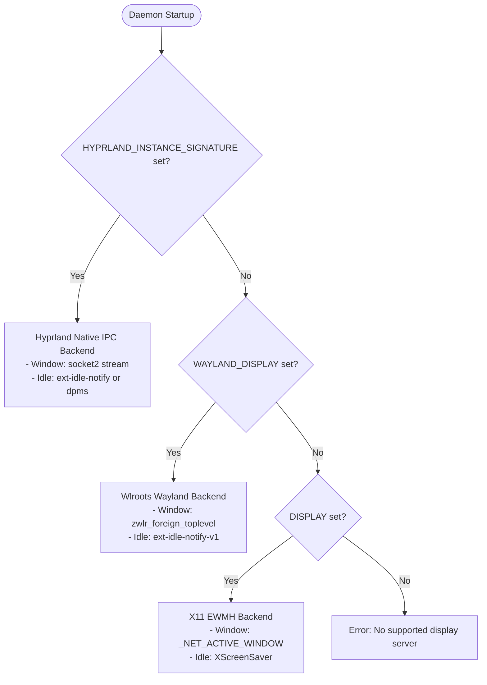

# Research: Linux wlroots and Hyprland Window and Idle Tracking in Rust

**Ticket**: `06-linux-wlroots-and-hyprland-window-and-idle-tracking.md`  
**Status**: Completed  
**Author**: Antigravity Subagent  
**Date**: November 2026  

---

## 1. Executive Summary

This document presents the architecture, protocol mechanics, crate selections, and concrete Rust implementations for tracking active windows and user idle transitions on **Hyprland** and standard **wlroots-based Wayland compositors** (Sway, River, Wayfire, Labwc).

### Key Architectural Findings

1. **Hyprland Should Use Native Socket IPC (Zero FFI)**:
   - Hyprland exposes dedicated Unix domain sockets (`.socket.sock` for commands and `.socket2.sock` for event streaming) at `$XDG_RUNTIME_DIR/hypr/$HYPRLAND_INSTANCE_SIGNATURE/`.
   - Streaming `activewindow>>CLASS,TITLE` over `socket2` with Tokio's `UnixStream` is lightweight, robust, and requires **no C libraries or Wayland protocol bindings**.
   - The initial active window query can be made directly via socket 1 by writing `j/activewindow\n`, eliminating the Python daemon's 5–10 ms subprocess fork of `hyprctl activewindow -j`.
   - **Avoid the third-party `hyprland` crate**: It carries a GPL-3.0 license (which would contaminate screentime's MIT/Apache-2.0 codebase) and heavy transitive dependencies. Direct socket parsing is under 80 lines of pure Rust.

2. **Generic wlroots Compositors Should Use `zwlr_foreign_toplevel_manager_v1`**:
   - Sway, River, and generic wlroots compositors do not share Hyprland's socket2 IPC. Window tracking requires the `wlr-foreign-toplevel-management-unstable-v1` protocol.
   - Each toplevel handle (`ZwlrForeignToplevelHandleV1`) provides `app_id` (mapping to `app_class`), `title`, and `state` events.
   - Focus is signaled by the presence of `State::Activated` in the state array.
   - **Strict Latching**: Wayland protocol rules mandate that updates must be buffered until the atomic `done` event is received before triggering active window changes.

3. **Wayland Idle Detection: Composite Protocol Strategy**:
   - **Primary (Inactivity)**: `ext-idle-notify-v1` (Wayland staging protocol in `wayland-protocols`). It allows setting an idle timeout (e.g. 180s) and **automatically respects Wayland idle inhibitors** (`idle-inhibit-unstable-v1`), ensuring full-screen video, presentations, or conference calls correctly count as screen time.
   - **Auxiliary (DPMS Screen Off)**: `zwlr_output_power_manager_v1` (wlroots protocol in `wayland-protocols-wlr`). Detects physical display power modes (`Mode::Off` vs `Mode::On`), providing instant idle transitions when screens blank or lock before timeout.
   - **Hyprland Pure Fallback**: Hyprland allows tracking DPMS via `dpms>>` events on `socket2` or polling `j/monitors` on `socket1`, enabling a 100% zero-FFI daemon mode for Hyprland users.

4. **Tokio Async Integration via `AsyncFd`**:
   - Instead of dedicating a blocked OS thread to `event_queue.blocking_dispatch()`, `wayland-client` 0.31 integrates natively into Tokio's async reactor using `tokio::io::unix::AsyncFd` with `Connection::prepare_read()` and `EventQueue::dispatch_pending()`.
   - This provides cooperative async cancellation via `tokio::select!` and `tokio_util::sync::CancellationToken` with zero thread contention.

---

## 2. Analysis of the Legacy Python Implementation

In the Python daemon:

### 2.1 Window Tracking (`screentime/tracker.py`)
- **Strengths**:
  - Connected to Hyprland's `socket2` at `$XDG_RUNTIME_DIR/hypr/$HIS/.socket2.sock`.
  - Parsed `activewindow>>CLASS,TITLE` line-by-line using `payload.split(",", 1)`.
  - Treated `activewindow>>,` or empty classes as "no window focused".
- **Shortcomings**:
  - Querying the initial active window used `asyncio.create_subprocess_exec("hyprctl", "activewindow", "-j")`. Forking a subprocess on Linux incurs process creation overhead, memory copying, and binary search in `$PATH`.
  - Completely lacked support for non-Hyprland Wayland compositors (Sway, River, Wayfire).

### 2.2 Idle Tracking (`screentime/idle.py`)
- **Strengths**:
  - Implemented `WlrOutputPowerBackend` via `pywayland` and `zwlr_output_power_manager_v1` to track display DPMS mode (`mode == 0` for off, `1` for on).
  - Integrated with the asyncio loop via `loop.add_reader(display.get_fd(), ...)`.
  - Included a fallback `HyprctlPollingBackend` that polled `j/monitors` over `.socket.sock` every 2.0 seconds.
- **Shortcomings**:
  - DPMS tracking only detects when the monitor powers off. If the user stops interacting with their computer but their screen timeout is 10 minutes, the Python daemon continued accumulating screen time for the active application for the full 10 minutes.
  - Did not utilize `ext-idle-notify-v1`, which triggers idle notifications based on actual user input inactivity while honoring media playback inhibitors.

---

## 3. Hyprland Native IPC Architecture in Rust

### 3.1 Socket Discovery
Hyprland stores its IPC sockets in a directory identified by `$HYPRLAND_INSTANCE_SIGNATURE`:

```
$XDG_RUNTIME_DIR/hypr/$HYPRLAND_INSTANCE_SIGNATURE/
├── .socket.sock   # Socket 1: Request/Response command socket (hyprctl)
└── .socket2.sock  # Socket 2: Continuous real-time event stream
```

If `$XDG_RUNTIME_DIR` is not populated, older Hyprland versions fall back to `/tmp/hypr/$HYPRLAND_INSTANCE_SIGNATURE/`.

```rust
use std::path::PathBuf;

#[derive(Debug, thiserror::Error)]
pub enum HyprlandError {
    #[error("HYPRLAND_INSTANCE_SIGNATURE environment variable not set")]
    NotRunning,
    #[error("Hyprland socket directory not found for instance: {0}")]
    SocketNotFound(String),
    #[error("I/O error: {0}")]
    Io(#[from] std::io::Error),
    #[error("JSON decode error: {0}")]
    Json(#[from] serde_json::Error),
}

pub fn get_hyprland_socket_dir() -> Result<PathBuf, HyprlandError> {
    let his = std::env::var("HYPRLAND_INSTANCE_SIGNATURE")
        .map_err(|_| HyprlandError::NotRunning)?;

    if let Ok(xdg) = std::env::var("XDG_RUNTIME_DIR") {
        let dir = PathBuf::from(xdg).join("hypr").join(&his);
        if dir.join(".socket2.sock").exists() {
            return Ok(dir);
        }
    }

    let tmp_dir = PathBuf::from("/tmp").join("hypr").join(&his);
    if tmp_dir.join(".socket2.sock").exists() {
        return Ok(tmp_dir);
    }

    Err(HyprlandError::SocketNotFound(his))
}
```

### 3.2 Socket 1 One-Shot Query (`j/activewindow`)
Instead of launching `hyprctl activewindow -j`, connect to `.socket.sock` directly:

```rust
use tokio::io::{AsyncReadExt, AsyncWriteExt};
use tokio::net::UnixStream;
use std::path::Path;

#[derive(Debug, Clone, PartialEq, Eq)]
pub struct WindowInfo {
    pub app_class: String,
    pub title: String,
}

pub async fn query_active_window(socket_dir: &Path) -> Result<Option<WindowInfo>, HyprlandError> {
    let socket_path = socket_dir.join(".socket.sock");
    let mut stream = UnixStream::connect(&socket_path).await?;
    stream.write_all(b"j/activewindow\n").await?;

    let mut buf = Vec::with_capacity(1024);
    stream.read_to_end(&mut buf).await?;

    if buf.is_empty() {
        return Ok(None);
    }

    let val: serde_json::Value = serde_json::from_slice(&buf)?;
    let app_class = val.get("class").and_then(|v| v.as_str()).unwrap_or("").trim();
    if app_class.is_empty() {
        return Ok(None);
    }

    let title = val.get("title").and_then(|v| v.as_str()).unwrap_or("").trim();
    Ok(Some(WindowInfo {
        app_class: app_class.to_string(),
        title: title.to_string(),
    }))
}
```

### 3.3 Socket 2 Event Streaming
The socket2 stream emits lines in `EVENT>>PAYLOAD\n` format:
- `activewindow>>CLASS,TITLE`
- When unmapped or desktop clicked: `activewindow>>,` or `activewindow>>`
- **Commas in titles**: Titles can contain commas (e.g., `activewindow>>code,main.rs - screentime, edited`). We must split on the **first comma only** using `payload.split_once(',')`.

```rust
use tokio::io::{AsyncBufReadExt, BufReader};
use tokio_util::sync::CancellationToken;
use tracing::{info, warn, error};

pub async fn run_hyprland_window_stream<F, Fut>(
    socket_dir: PathBuf,
    cancel_token: CancellationToken,
    mut on_window_change: F,
) where
    F: FnMut(Option<WindowInfo>) -> Fut,
    Fut: std::future::Future<Output = ()>,
{
    let socket2_path = socket_dir.join(".socket2.sock");

    while !cancel_token.is_cancelled() {
        match UnixStream::connect(&socket2_path).await {
            Ok(stream) => {
                info!("Connected to Hyprland socket2 stream");

                // Immediately query baseline window on successful connection
                if let Ok(initial_win) = query_active_window(&socket_dir).await {
                    on_window_change(initial_win).await;
                }

                let reader = BufReader::new(stream);
                let mut lines = reader.lines();

                loop {
                    tokio::select! {
                        _ = cancel_token.cancelled() => return,
                        res = lines.next_line() => {
                            match res {
                                Ok(Some(line)) => {
                                    if let Some(payload) = line.strip_prefix("activewindow>>") {
                                        let window = parse_active_window_payload(payload);
                                        on_window_change(window).await;
                                    }
                                }
                                Ok(None) => {
                                    warn!("Hyprland socket2 closed (EOF), reconnecting in 2s...");
                                    break;
                                }
                                Err(e) => {
                                    warn!("Error reading Hyprland socket2: {e}, reconnecting in 2s...");
                                    break;
                                }
                            }
                        }
                    }
                }
            }
            Err(e) => {
                warn!("Cannot connect to Hyprland socket2: {e}. Retrying in 2s...");
            }
        }

        tokio::select! {
            _ = cancel_token.cancelled() => return,
            _ = tokio::time::sleep(std::time::Duration::from_secs(2)) => {}
        }
    }
}

fn parse_active_window_payload(payload: &str) -> Option<WindowInfo> {
    let payload = payload.trim();
    if payload.is_empty() || payload == "," {
        return None;
    }

    let (class, title) = match payload.split_once(',') {
        Some((c, t)) => (c.trim(), t.trim()),
        None => (payload, ""),
    };

    if class.is_empty() {
        return None;
    }

    Some(WindowInfo {
        app_class: class.to_string(),
        title: title.to_string(),
    })
}
```

---

## 4. Standard Wayland Window Tracking (`zwlr_foreign_toplevel_manager_v1`)

For non-Hyprland wlroots compositors (Sway, River, Wayfire, Labwc), window tracking relies on the wlroots foreign toplevel management protocol.

### 4.1 Crate Dependencies
```toml
[dependencies]
wayland-client = { version = "0.31", features = ["dlopen"] }
wayland-protocols = { version = "0.32", features = ["client", "staging"] }
wayland-protocols-wlr = { version = "0.3", features = ["client"] }
```
*(Using `dlopen` allows the binary to run on systems where `libwayland-client.so` may not be present at build time).*

### 4.2 Protocol Architecture & Latching
1. **Manager Global**: Client binds `zwlr_foreign_toplevel_manager_v1`.
2. **Handle Events**: Compositor emits `Toplevel { toplevel }` for each window, returning a `ZwlrForeignToplevelHandleV1`.
3. **Atomic Transactions**: As window state changes, the compositor emits individual attribute updates (`title`, `app_id`, `state`), culminating in `done`. State must be buffered in `pending_*` fields and only applied upon `done`.
4. **State Array**: The `state` event passes a `Vec<u8>`. Each 4 bytes represents a 32-bit integer matching `zwlr_foreign_toplevel_handle_v1::State`. Value `2` corresponds to `State::Activated`.

### 4.3 State Machine Implementation
```rust
use std::collections::HashMap;
use wayland_client::{
    protocol::wl_registry::{self, WlRegistry},
    Connection, Dispatch, QueueHandle,
};
use wayland_protocols_wlr::foreign_toplevel::v1::client::{
    zwlr_foreign_toplevel_handle_v1::{self, ZwlrForeignToplevelHandleV1, State},
    zwlr_foreign_toplevel_manager_v1::{self, ZwlrForeignToplevelManagerV1},
};

#[derive(Default)]
struct ToplevelState {
    app_id: Option<String>,
    title: Option<String>,
    is_active: bool,

    pending_app_id: Option<String>,
    pending_title: Option<String>,
    pending_is_active: bool,
}

pub struct WlrWindowState {
    manager: Option<ZwlrForeignToplevelManagerV1>,
    windows: HashMap<ZwlrForeignToplevelHandleV1, ToplevelState>,
    current_active_window: Option<WindowInfo>,
    sender: tokio::sync::mpsc::UnboundedSender<Option<WindowInfo>>,
}

impl Dispatch<WlRegistry, ()> for WlrWindowState {
    fn event(
        state: &mut Self,
        registry: &WlRegistry,
        event: wl_registry::Event,
        _: &(),
        _: &Connection,
        qh: &QueueHandle<Self>,
    ) {
        if let wl_registry::Event::Global { name, interface, version } = event {
            if interface == "zwlr_foreign_toplevel_manager_v1" {
                state.manager = Some(
                    registry.bind::<ZwlrForeignToplevelManagerV1, _, _>(name, version.min(3), qh, ())
                );
            }
        }
    }
}

impl Dispatch<ZwlrForeignToplevelManagerV1, ()> for WlrWindowState {
    fn event(
        state: &mut Self,
        _: &ZwlrForeignToplevelManagerV1,
        event: zwlr_foreign_toplevel_manager_v1::Event,
        _: &(),
        _: &Connection,
        _: &QueueHandle<Self>,
    ) {
        if let zwlr_foreign_toplevel_manager_v1::Event::Toplevel { toplevel } = event {
            state.windows.insert(toplevel, ToplevelState::default());
        }
    }
}

impl Dispatch<ZwlrForeignToplevelHandleV1, ()> for WlrWindowState {
    fn event(
        state: &mut Self,
        handle: &ZwlrForeignToplevelHandleV1,
        event: zwlr_foreign_toplevel_handle_v1::Event,
        _: &(),
        _: &Connection,
        _: &QueueHandle<Self>,
    ) {
        match event {
            zwlr_foreign_toplevel_handle_v1::Event::Title { title } => {
                if let Some(win) = state.windows.get_mut(handle) {
                    win.pending_title = Some(title);
                }
            }
            zwlr_foreign_toplevel_handle_v1::Event::AppId { app_id } => {
                if let Some(win) = state.windows.get_mut(handle) {
                    win.pending_app_id = Some(app_id);
                }
            }
            zwlr_foreign_toplevel_handle_v1::Event::State { state: state_bytes } => {
                let is_active = state_bytes
                    .chunks_exact(4)
                    .map(|c| u32::from_ne_bytes(c.try_into().unwrap()))
                    .any(|val| val == State::Activated as u32);

                if let Some(win) = state.windows.get_mut(handle) {
                    win.pending_is_active = is_active;
                }
            }
            zwlr_foreign_toplevel_handle_v1::Event::Done => {
                if let Some(win) = state.windows.get_mut(handle) {
                    // Commit atomic batch
                    if let Some(app_id) = win.pending_app_id.take() {
                        win.app_id = Some(app_id);
                    }
                    if let Some(title) = win.pending_title.take() {
                        win.title = Some(title);
                    }
                    win.is_active = win.pending_is_active;
                }
                state.recalculate_active_window();
            }
            zwlr_foreign_toplevel_handle_v1::Event::Closed => {
                state.windows.remove(handle);
                handle.destroy();
                state.recalculate_active_window();
            }
            _ => {}
        }
    }
}

impl WlrWindowState {
    fn recalculate_active_window(&mut self) {
        let active = self.windows.values().find(|w| w.is_active);
        let new_win_info = active.and_then(|w| {
            let app_class = w.app_id.as_deref().unwrap_or("").trim();
            if app_class.is_empty() {
                return None;
            }
            let title = w.title.as_deref().unwrap_or("").trim();
            Some(WindowInfo {
                app_class: app_class.to_string(),
                title: title.to_string(),
            })
        });

        if new_win_info != self.current_active_window {
            self.current_active_window = new_win_info.clone();
            let _ = self.sender.send(new_win_info);
        }
    }
}
```

---

## 5. Wayland Idle Detection: Composite Protocol Strategy

A robust screen time daemon must differentiate between:
1. **User Inactivity**: Keyboard and mouse idle timeouts (e.g. user walked away from the desk).
2. **Idle Inhibitors**: Video playback (YouTube, VLC), video conferencing, or games preventing the screen from locking.
3. **Display Power State (DPMS)**: The physical screens turned off or locked immediately.

### 5.1 Protocol Comparison

| Feature | `ext-idle-notify-v1` | `zwlr_output_power_manager_v1` | Hyprland IPC `j/monitors` |
|---|---|---|---|
| **Specification** | Wayland Staging (`wayland-protocols`) | wlroots Unstable (`wayland-protocols-wlr`) | Hyprland Custom IPC |
| **Compositor Support** | Sway, Hyprland, River, KDE Plasma 6 | Sway, Hyprland, Wayfire, Labwc | Hyprland only |
| **Detection Basis** | User input timeout (milliseconds) | Monitor power mode (On/Off) | Monitor power mode (On/Off) |
| **Respects Inhibitors** | Yes (`get_idle_notification`) | Delegated to compositor idle manager | Delegated to compositor idle manager |
| **Event Driven** | Yes (`idled` / `resumed`) | Yes (`mode` event) | Polling or `dpms>>` event |
| **C Library Needed** | Yes (`libwayland-client`) | Yes (`libwayland-client`) | No (Pure Unix socket) |

### 5.2 Implementation of `ext-idle-notify-v1`
Using `get_idle_notification(timeout_ms, &seat, &qh, ())`:

```rust
use wayland_client::protocol::wl_seat::WlSeat;
use wayland_protocols::ext::idle_notify::v1::client::{
    ext_idle_notification_v1::{self, ExtIdleNotificationV1},
    ext_idle_notifier_v1::{self, ExtIdleNotifierV1},
};

pub struct IdleState {
    pub notifier: Option<ExtIdleNotifierV1>,
    pub notification: Option<ExtIdleNotificationV1>,
    pub is_idle: bool,
    pub sender: tokio::sync::mpsc::UnboundedSender<bool>,
}

impl Dispatch<ExtIdleNotifierV1, ()> for IdleState {
    fn event(
        _: &mut Self,
        _: &ExtIdleNotifierV1,
        _: ext_idle_notifier_v1::Event,
        _: &(),
        _: &Connection,
        _: &QueueHandle<Self>,
    ) {}
}

impl Dispatch<ExtIdleNotificationV1, ()> for IdleState {
    fn event(
        state: &mut Self,
        _: &ExtIdleNotificationV1,
        event: ext_idle_notification_v1::Event,
        _: &(),
        _: &Connection,
        _: &QueueHandle<Self>,
    ) {
        match event {
            ext_idle_notification_v1::Event::Idled => {
                if !state.is_idle {
                    state.is_idle = true;
                    let _ = state.sender.send(true); // User went idle
                }
            }
            ext_idle_notification_v1::Event::Resumed => {
                if state.is_idle {
                    state.is_idle = false;
                    let _ = state.sender.send(false); // User became active
                }
            }
            _ => {}
        }
    }
}
```

### 5.3 Implementation of `zwlr_output_power_manager_v1`
Tracking monitor DPMS mode:

```rust
use wayland_client::protocol::wl_output::WlOutput;
use wayland_protocols_wlr::output_power_management::v1::client::{
    zwlr_output_power_manager_v1::{self, ZwlrOutputPowerManagerV1},
    zwlr_output_power_v1::{self, ZwlrOutputPowerV1, Mode},
};

pub struct DpmsState {
    power_mgr: Option<ZwlrOutputPowerManagerV1>,
    monitors: HashMap<ZwlrOutputPowerV1, bool>, // true = ON, false = OFF
    sender: tokio::sync::mpsc::UnboundedSender<bool>,
}

impl Dispatch<ZwlrOutputPowerV1, ()> for DpmsState {
    fn event(
        state: &mut Self,
        proxy: &ZwlrOutputPowerV1,
        event: zwlr_output_power_v1::Event,
        _: &(),
        _: &Connection,
        _: &QueueHandle<Self>,
    ) {
        if let zwlr_output_power_v1::Event::Mode { mode } = event {
            let is_on = match mode {
                wayland_client::WEnum::Value(Mode::On) => true,
                wayland_client::WEnum::Value(Mode::Off) => false,
                _ => true,
            };
            state.monitors.insert(proxy.clone(), is_on);

            // If ANY screen is ON, system display is active. If ALL screens are OFF, user is idle.
            let screen_active = state.monitors.values().any(|&active| active);
            let is_idle = !screen_active;
            let _ = state.sender.send(is_idle);
        }
    }
}
```

---

## 6. Tokio Async Integration via `AsyncFd`

A key design question is whether Wayland dispatching requires a dedicated OS thread.  
With `wayland-client` 0.31, **no background thread is required**. Tokio's `AsyncFd` wraps the Wayland socket file descriptor, enabling seamless integration into the Tokio async reactor with instant cancellation.

### The Race-Free Read/Dispatch Loop
Wayland socket reads must coordinate `prepare_read()`, poll readiness, and `dispatch_pending()`:

```rust
use std::os::unix::io::AsRawFd;
use tokio::io::unix::AsyncFd;
use wayland_client::{Connection, EventQueue};
use tokio_util::sync::CancellationToken;

pub async fn run_wayland_event_loop<S>(
    conn: Connection,
    mut event_queue: EventQueue<S>,
    mut state: S,
    cancel_token: CancellationToken,
) -> Result<(), Box<dyn std::error::Error + Send + Sync>> {
    // Dispatch globals bound during connection setup
    event_queue.dispatch_pending(&mut state)?;

    let raw_fd = conn.backend().as_raw_fd();
    let async_fd = AsyncFd::new(raw_fd)?;

    loop {
        // Step 1: Drain any events already parsed into queue buffers
        event_queue.dispatch_pending(&mut state)?;

        // Step 2: Flush outgoing messages to compositor
        conn.flush()?;

        // Step 3: Prepare to read from the socket
        let guard = match conn.prepare_read() {
            Some(g) => g,
            None => {
                // If None, events were buffered during prepare; dispatch them immediately
                event_queue.dispatch_pending(&mut state)?;
                continue;
            }
        };

        // Step 4: Await socket readability asynchronously
        tokio::select! {
            _ = cancel_token.cancelled() => {
                // Dropping `guard` safely cancels the read intent in libwayland
                break;
            }
            res = async_fd.readable() => {
                let mut ready_guard = res?;
                // Step 5: Read raw bytes into internal buffers
                match guard.read_events() {
                    Ok(_) => {
                        ready_guard.clear_ready();
                        event_queue.dispatch_pending(&mut state)?;
                    }
                    Err(e) if e.kind() == std::io::ErrorKind::WouldBlock => {
                        ready_guard.clear_ready();
                    }
                    Err(e) => return Err(Box::new(e)),
                }
            }
        }
    }

    Ok(())
}
```

---

## 7. Dynamic Compositor Detection Strategy

At daemon startup, `screentimed` should inspect the runtime environment to automatically pick the most efficient backend:



### Detection Logic in Rust:
```rust
pub enum DesktopEnvironment {
    Hyprland { socket_dir: PathBuf },
    WlrootsWayland,
    KdePlasma,
    X11,
}

pub fn detect_environment() -> Result<DesktopEnvironment, String> {
    if let Ok(socket_dir) = get_hyprland_socket_dir() {
        return Ok(DesktopEnvironment::Hyprland { socket_dir });
    }

    let desktop = std::env::var("XDG_CURRENT_DESKTOP").unwrap_or_default().to_lowercase();
    if desktop.contains("kde") {
        return Ok(DesktopEnvironment::KdePlasma);
    }

    if std::env::var("WAYLAND_DISPLAY").is_ok() {
        return Ok(DesktopEnvironment::WlrootsWayland);
    }

    if std::env::var("DISPLAY").is_ok() {
        return Ok(DesktopEnvironment::X11);
    }

    Err("No supported display environment detected ($WAYLAND_DISPLAY or $DISPLAY missing)".into())
}
```

---

## 8. Summary of Recommendations for `screentimed`

1. **Hyprland Window Tracker**:
   - Implement `HyprlandWindowTracker` using `tokio::net::UnixStream` directly on `.socket2.sock`.
   - Query initial state via `.socket.sock` with `j/activewindow`.
   - **Zero C dependencies, zero FFI, zero third-party IPC crates**.

2. **Wlroots Wayland Window Tracker**:
   - Implement `WlrForeignToplevelTracker` using `wayland-client` and `wayland-protocols-wlr`.
   - Latch state changes on `Done` event before emitting `WindowInfo`.

3. **Wayland Idle Detector**:
   - Implement `WaylandIdleDetector` using `ext-idle-notify-v1` with a configurable timeout (e.g. 180s) to track input inactivity while honoring application idle inhibitors.
   - Combine with `zwlr_output_power_manager_v1` to trigger immediate idle when screens turn off via DPMS.

4. **Async Runtime**:
   - Integrate `wayland-client` into Tokio using `AsyncFd` rather than spawning dedicated OS threads.

5. **Licensing**:
   - Stick to `wayland-client` / `wayland-protocols` (MIT). Do not use the `hyprland` crate (GPL-3.0).
