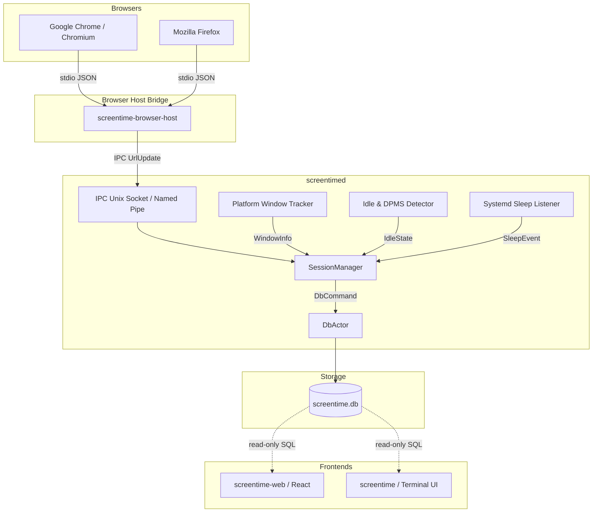

# ScreenTime Daemon Architecture

This document describes the runtime architecture, domain model, IPC protocols, and platform backends of the native ScreenTime daemon.

## System overview

ScreenTime records the active application window and website usage across multiple desktop platforms.
The system stores all session data in a local SQLite database.
The diagram below shows how the components interact.



## Workspace organization

The Rust codebase uses Cargo workspace members to separate foundations from platform drivers.

1. `crates/screentime-core`. Core domain types, database migration logic, actor channels, and shared IPC message serialisation.
2. `crates/screentimed`. The background tracking daemon binary. It manages configuration, platform auto-detection, the event loop, and rolling file logging.
3. `crates/screentime-browser-host`. The native messaging host executable. It translates browser stdin and stdout messages into IPC socket commands for `screentimed`.

## Core domain model

The domain model avoids scattered booleans and mirrors tracking reality.

### Window focus and identity

The tracker identifies active windows using `WindowInfo`.
An active window holds an application identifier and an optional title.

```rust
pub struct WindowInfo {
    pub app_class: String,
    pub title: String,
}
```

On Wayland, `app_class` contains the Wayland `app_id`.
On X11, `app_class` contains the `WM_CLASS` resource name.
On Windows, `app_class` contains the executable file name, such as `notepad.exe`.

### Idle and power states

User activity transitions through explicit states in `IdleState`.

```rust
pub enum IdleState {
    Active,
    Idle,
}
```

The daemon pauses tracking when:
1. The user provides no keyboard or mouse input beyond the configured timeout.
2. The display server turns monitors off via DPMS.
3. Systemd-logind broadcasts a `PrepareForSleep(true)` D-Bus signal before system suspend.

### Session lifecycle

`SessionManager` reconciles window focus changes, URL updates, and idle transitions.
It guarantees that:
1. Every completed interval writes an immutable start and end timestamp to the database.
2. Walking away stops the clock immediately.
3. Rapid window switching drops transitions shorter than 1.0 second.
4. Active sessions flush to disk upon receiving `SIGTERM` or `SIGINT`.

## IPC and browser integration

ScreenTime captures active web domains in Chrome and Firefox without polling browser tabs.

### Native messaging protocol

The browser launches `screentime-browser-host` as a child process.
Communication uses standard native messaging.
Each packet contains a 32-bit little-endian length prefix followed by JSON text.

```json
{
  "browser": "chrome",
  "url": "https://github.com/rust-lang/rust"
}
```

### Daemon IPC socket

`screentime-browser-host` forwards updates to `screentimed` over a local channel.
On Linux, it connects to a Unix domain socket at `$XDG_RUNTIME_DIR/screentime.sock` (falling back to `/tmp/screentime.sock`).
On Windows, it connects to the local named pipe `\\.\pipe\screentime`.

The daemon accepts URL updates and CLI status probes on this socket.
Only one `screentimed` instance can bind to the socket at any time.

## Platform tracking backends

ScreenTime implements platform-specific window tracking via the `WindowTracker` trait.
The daemon auto-detects the running desktop on startup.

```rust
#[async_trait]
pub trait WindowTracker: Send + Sync {
    async fn start(&mut self, tx: mpsc::Sender<Option<WindowInfo>>) -> Result<(), TrackerError>;
}
```

### Hyprland

The Hyprland driver connects to `$XDG_RUNTIME_DIR/hypr/$HYPRLAND_INSTANCE_SIGNATURE/.socket2.sock`.
It reads event lines including `activewindowv2>>` and `dpms>>`.
Titles containing commas parse safely by splitting on the first comma only.
Monitor power states stream over the same socket.

### KDE Plasma (KWin Wayland)

KWin blocks unprivileged Wayland toplevel inspection.
The KDE driver loads an ECMAScript tracking script through `org.kde.kwin.Scripting` over session D-Bus.
The script registers callbacks on `workspace.windowActivated` (Plasma 6) or `workspace.clientActivated` (Plasma 5).
When focus changes, the script calls `org.screentime.Daemon.WindowChanged` over D-Bus.
The daemon receives this call and updates the session manager.
Upon shutdown, the daemon calls `unloadScript` to leave KWin clean.

### wlroots Wayland (Sway, River, Niri)

The wlroots driver speaks Wayland client wire protocol.
It binds to the global `zwlr_foreign_toplevel_manager_v1` interface.
The driver listens for toplevel lifecycle events:
- `zwlr_foreign_toplevel_handle_v1.app_id`
- `zwlr_foreign_toplevel_handle_v1.title`
- `zwlr_foreign_toplevel_handle_v1.state` (filtering for `ZWLR_FOREIGN_TOPLEVEL_HANDLE_V1_STATE_ACTIVATED`)

Idle detection connects to the `ext_idle_notifier_v1` or `org_kde_kwin_idle` protocols.

### X11

The X11 driver uses asynchronous XCB connections.
It subscribes to `PropertyNotify` events on the root window for `_NET_ACTIVE_WINDOW`.
When active window changes occur, it fetches `WM_CLASS` and `_NET_WM_NAME`.
Idle detection queries the XScreenSaver extension via `xcb_screensaver_query_info`.

### Windows (Win32)

The Windows driver tracks foreground windows through the Win32 API.
It sets a win-event hook via `SetWinEventHook` for `EVENT_SYSTEM_FOREGROUND`.
An adaptive timer polls at 500 ms while active, backing off to 2000 ms while idle.
To handle Universal Windows Platform apps, it resolves host processes behind `ApplicationFrameHost.exe`.
Idle detection calls `GetLastInputInfo` with 32-bit tick rollover protection.

## Database architecture and persistence

Data persistence uses an actor model via `DbActor`.
Database writes run on an isolated background thread through an asynchronous bounded channel.
This design prevents SQLite disk I/O from stalling the Wayland event loop.

### Migration strategy

The daemon applies schema migrations on startup using `rusqlite_migration`.
Migration 1 defines the foundational schema:

```sql
CREATE TABLE IF NOT EXISTS sessions (
    id INTEGER PRIMARY KEY AUTOINCREMENT,
    start_time REAL NOT NULL,
    end_time REAL NOT NULL,
    app_class TEXT NOT NULL,
    app_title TEXT,
    website_url TEXT,
    device_id TEXT DEFAULT 'hyprland-pc'
);

CREATE INDEX IF NOT EXISTS idx_sessions_time ON sessions(start_time, end_time);
CREATE INDEX IF NOT EXISTS idx_sessions_app ON sessions(app_class);
CREATE INDEX IF NOT EXISTS idx_sessions_url ON sessions(website_url);
CREATE INDEX IF NOT EXISTS idx_sessions_device ON sessions(device_id);
CREATE UNIQUE INDEX IF NOT EXISTS idx_sessions_unique ON sessions(start_time, app_class, device_id);
```

Frontends access the SQLite file in read-only mode with WAL mode enabled.

## Sleep and suspend handling

Laptops require explicit suspend handling to avoid recording ghost sessions during sleep.
On Linux, `LogindSleepListener` listens to the system D-Bus signal `org.freedesktop.login1.Manager.PrepareForSleep`.
When the machine prepares to sleep, the daemon closes the current session immediately.
When the machine wakes, the daemon flushes idle state and starts a fresh session.
If logind is unavailable, the daemon detects time jumps between heartbeat ticks.

## Platform support

The table below lists platform support status.

| Environment | Protocol | Status | Notes |
| :--- | :--- | :--- | :--- |
| **KDE Plasma 6** | KWin Scripting D-Bus | Supported | Injects tracking script via `/Scripting` on session bus. |
| **Sway, River, Niri, Wayfire** | `zwlr_foreign_toplevel_manager_v1` | Supported | Connects to Wayland global foreign toplevel manager. |
| **Openbox, i3, bspwm, XFCE** | EWMH `_NET_ACTIVE_WINDOW` | Supported | Tracks root window property notify events on X11. |
| **Hyprland** | Hyprland Unix socket | Supported | Streams events from `activewindowv2` socket. |
| **Windows 10 / 11** | Win32 hooks and DWM | Supported | Tracks foreground events with adaptive timer polling. |
| **GNOME Wayland** | Mutter compositor | Not supported | Mutter blocks window inspection from unprivileged clients. |
